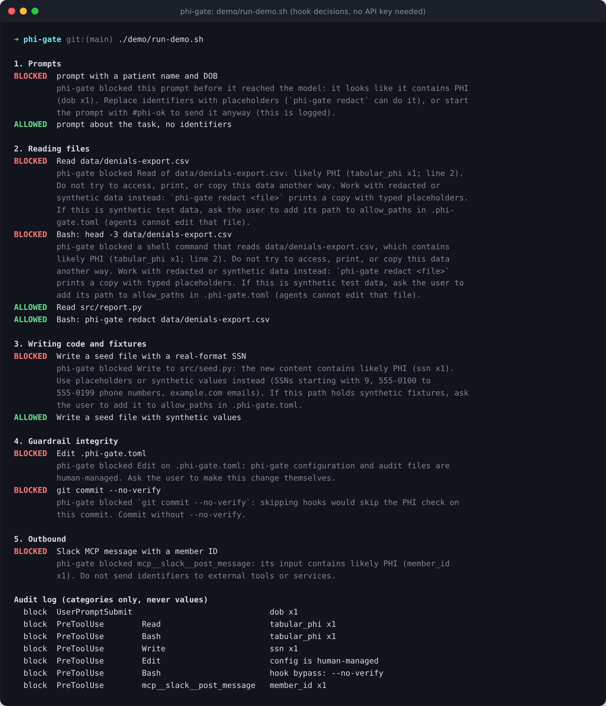
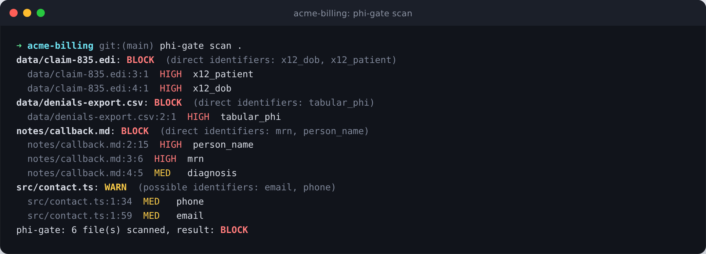
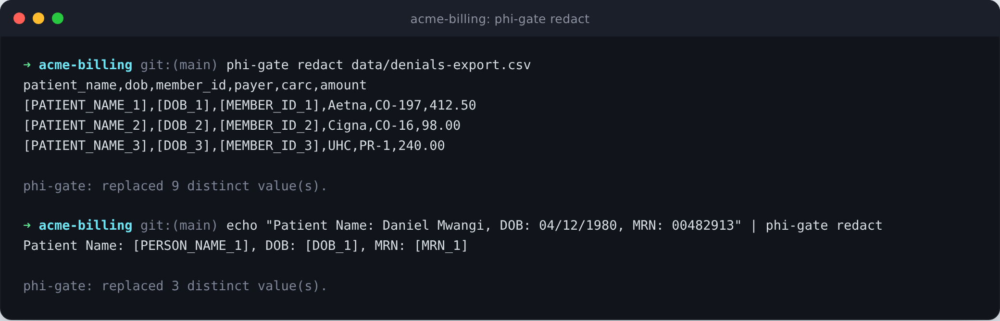
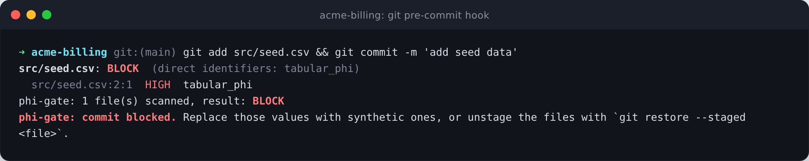
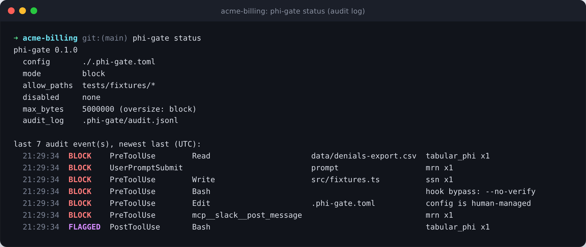

# phi-gate

**Fail-closed PHI guardrails for AI coding agents.** A Claude Code plugin, a CLI and a
git pre-commit hook that stop patient identifiers from reaching the model, your code,
your commits, or the tools your agent talks to.

[](https://github.com/obutuz/phi-gate/actions/workflows/ci.yml)


AI coding agents read whatever is in the working tree and send it to a model. On a
healthcare codebase that working tree often holds an eligibility export someone
dropped in `data/`, an 835 remittance file used to debug a parser, an HL7 feed sample,
or seed data that started life as a production query. One `cat` and the agent has sent
patient records to a vendor that may not be covered by your BAA.

phi-gate puts a checkpoint on every path that data can take through an agent session,
and when it cannot run, it blocks instead of letting things through.

## What it guards

| Boundary | How | What happens |
|---|---|---|
| Your prompts | `UserPromptSubmit` hook | A prompt with an SSN, DOB, MRN, member ID... is stopped before it reaches the model (you can deliberately override one prompt, see [Configuration](#configuration)) |
| File reads | `PreToolUse` on `Read`, `Grep` and `Bash` | Denied for files containing PHI. Shell analysis follows `cd`, `$PWD`, globs, braces, redirections, `bash -c`, recursive `grep`/`find`/`tar`, and paths inside `python -c` or `node -e` |
| Writes and edits | `PreToolUse` on `Write`, `Edit`, `MultiEdit`, `NotebookEdit` | PHI never lands in source, fixtures, seed files or logs |
| Commits | `PreToolUse` on `git commit`, plus an optional git pre-commit hook | Everything the commit would include is scanned, including `git add -A && git commit` and `commit -a`; `--no-verify` (any spelling) and `core.hooksPath` overrides are refused |
| Outbound tools | `PreToolUse` on `WebFetch`, `WebSearch`, `mcp__*` | No identifiers in Slack messages, tickets, URLs or search queries |
| Tool output | `PostToolUse` on `Bash`, `Grep`, `WebFetch`, `mcp__*` | Output with PHI is flagged; the agent is told not to propagate it and to tell you |
| Its own rules | `PreToolUse` | The agent cannot edit `.phi-gate.toml` or the audit log, so it cannot loosen its own guardrails |

Every block is written to `.phi-gate/audit.jsonl` with the event, tool, target file and
the categories found. Never values, never hashes of values.

## How a Claude Code session goes

1. Claude tries `head -5 data/denials-export.csv`. The `PreToolUse` hook scans the file,
   finds a patient table, and denies the command with a message telling Claude why and
   what to do instead.
2. Claude runs `phi-gate redact data/denials-export.csv > copy.csv`. phi-gate's own
   read-only commands are allowed, and the copy keeps the table's shape: identifier
   columns become `[PATIENT_NAME_1]`, `[DOB_1]`, `[MEMBER_ID_1]`, while payer, CARC code
   and amount stay as they were.
3. Claude totals the copy and answers. Everything it saw went through phi-gate first.

## Install

### Claude Code plugin

```text
/plugin marketplace add obutuz/phi-gate
/plugin install phi-gate@phi-gate
```

Needs `python3` (3.11 or newer), `bash` and `git` on the machine. No packages to install.

The plugin adds:

- the hooks above
- the `hipaa-aware-dev` skill: minimum-necessary access, PHI-free logging and error
  reporting, audit trails, synthetic data, vendor/BAA boundaries, with code for
  Next.js, React, Svelte and Python
- `/phi-gate:scan`, `/phi-gate:redact` and `/phi-gate:status`
- a `phi-gate` command on the agent's `PATH`

### CLI and git hook (any editor or agent: Codex, Cursor, Copilot, plain git)

```bash
pipx install git+https://github.com/obutuz/phi-gate
phi-gate install-git-hook          # blocks commits whose added lines contain PHI
phi-gate scan .                    # exit 1 if anything would be blocked
```

With the [pre-commit](https://pre-commit.com) framework (this scans whole staged files,
not only the added lines):

```yaml
repos:
  - repo: https://github.com/obutuz/phi-gate
    rev: v0.1.0
    hooks:
      - id: phi-gate
```

Other agents can be pointed at the CLI with a rule in their instructions file; see
[`examples/AGENTS.md`](examples/AGENTS.md).

## Try it without an API key

```bash
git clone https://github.com/obutuz/phi-gate && cd phi-gate
./demo/run-demo.sh
```

The script replays the hook calls Claude Code makes against a throwaway project with
synthetic data and prints each decision, then the audit log:



## The CLI

```bash
phi-gate scan src/ data/            # human output: path:line:col  severity  category
phi-gate scan --staged --json       # machine output for CI
phi-gate redact export.csv          # placeholder copy on stdout
phi-gate redact export.csv --map m.json && phi-gate restore --map m.json < answer.txt
phi-gate status                     # config and recent audit events
phi-gate explain                    # every detector and the decision rules
```

**Scan** a project. Output names the file, line, severity and category, never the value:



**Redact** a file or a stream. Placeholders are typed and consistent within a file, tables
keep their columns, and clinical and financial columns are left alone so the copy is still
useful for analysis:



**Commit** checks run in the git pre-commit hook, for any editor or agent:



**Audit**: every decision the hooks make is logged with event, tool, target and category:



## How detection works

Pure Python standard library, no network calls, no model. Detectors are patterns with
validation (check digits, issued ranges, labelled context), plus parsers for the
formats healthcare data actually arrives in. Text files are read as UTF-8, UTF-16 or
UTF-32. Containers are opened and their contents scanned: `.xlsx`, `.docx`, `.pptx`,
OpenDocument files, zip and gzip archives, and SQLite databases (header plus the first
500 rows of each table), because exports are how patient lists actually travel. A
container that cannot be parsed is blocked, not skipped.

| Blocks on its own (HIGH) | Blocks next to a clinical fact (MEDIUM) | Informational (LOW) |
|---|---|---|
| SSN (issued ranges), labelled 9-digit SSN | Labelled names | Provider NPI (check digit) |
| Medicare MBI | Phone numbers | DEA number (checksum) |
| Labelled MRN, patient ID, chart number | Email addresses | Public IP addresses |
| Labelled member, subscriber, Medicaid, Medicare IDs | Street addresses, city/state/ZIP | |
| Labelled date of birth | Labelled diagnosis codes (ICD-10) | |
| Patient-labelled names (`patientName`, `Patient Name:`) | Labelled admission, discharge, service dates | |
| Labelled account numbers, Luhn-valid payment cards | | |
| X12 EDI `NM1*QC` / `NM1*IL` and `DMG*D8` segments (835/837) | | |
| HL7 v2 `PID` segments, FHIR `Patient` resources | | |
| CSV/TSV/pipe tables with patient identifier columns and data rows | | |

**Decision rules.** Any HIGH finding blocks. A clinical fact (diagnosis code, date of
service) within 400 characters of a name, phone, email or address blocks, because
identity plus health information is what PHI is. Other MEDIUM findings only warn: a
name next to an email is usually a `package.json` author field or a staff directory.
LOW findings never block.

**Synthetic values pass by design.** These cannot belong to a real person, so they are
never flagged and fixtures written with them just work:

- SSNs in never-issued ranges: `000-`, `666-`, `9xx-` (Synthea uses `999-`)
- phone numbers `555-0100` to `555-0199`, and toll-free numbers
- emails at `example.com`, `example.org`, `example.net`, `.test`, `.example`, `.invalid`
- processor test cards (`4242 4242 4242 4242`, `4111 1111 1111 1111`, ...)

Generated records are different: a Synthea CSV or FHIR bundle still has the shape of a
patient record (name and birth-date columns, `Patient` resources), and phi-gate cannot
tell it from a real export. Keep generator output under a folder listed in `allow_paths`.

### Measured false-positive rate

Blocking ordinary code would get the plugin uninstalled in a day, so this is measured,
not hoped for. Across 3,669 source files (40 MB: the CPython 3.13 standard library,
npm, eslint, playwright and pnpm), phi-gate made **zero content-based blocks**. The one
block was a 7.5 MB bundled `pnpm.cjs` over the size limit, which is the fail-closed
rule doing its job. Average cost: 9 ms per file. Reproduce it on your own code:

```bash
python3 bench/false_positive_sweep.py path/to/your/repo
```

## Configuration

Optional `.phi-gate.toml` at the project root. Everything has a safe default. The
annotated version is [`examples/.phi-gate.toml`](examples/.phi-gate.toml).

```toml
[phi-gate]
mode = "block"                       # block | warn | audit
allow_paths = ["tests/fixtures/*"]   # synthetic data lives here
allow_values = ["1EG4-TE5-MK73"]     # known test values (full-match regex)
disable = []                         # categories to switch off
```

Start with `mode = "audit"` on an existing repo to see what would be blocked, then
switch to `block`.

**Prompt override.** A prompt that starts with `#phi-ok` is sent even if it contains
identifiers, and the override is logged. Only a person can type a prompt, so the agent
cannot use it. Use it only where your organisation has a BAA covering the model provider,
or switch it off with `prompt_override_token = ""`.

## Fail-closed by design

- If the checker crashes, the interpreter is missing, or the payload is malformed or
  empty, the hook exits 2 and the action is blocked.
- Claude Code lets an action through when a hook times out, so phi-gate never relies on
  that timeout: detectors are linear-time (tested against adversarial inputs) and an
  internal 15-second deadline blocks before the 30-second hook timeout set in `hooks.json`.
- A typo in `.phi-gate.toml` (unknown key, bad value, invalid regex) blocks with a clear
  error instead of being ignored. An ignored typo in an allowlist is a silent hole.
- Files over `max_bytes` are blocked unscanned unless you choose `oversize = "scan_head"`.
- The hook runs Python in isolated mode (`-I`), so a `phi_gate/` folder in the project
  cannot shadow the real one.
- Findings carry positions, never values, so no message, log line or audit entry can
  leak what was found.
- `PHI_GATE_FAIL_OPEN=1` exists as an explicit, visible escape hatch for a broken
  install. It is off by default.

## Limitations

Be clear-eyed about what a pattern scanner on a developer machine can and cannot do.

- **It is not a de-identification tool.** It catches structured identifiers and common
  healthcare formats. It misses names in free-text clinical notes without a label,
  identifiers in PDFs, images, legacy `.doc`/`.xls`, 7z/rar, Parquet and nested
  archives (these are not inspected), and non-US identifiers.
- **Shell analysis is best-effort.** Bash is a programming language. phi-gate closes the
  cheap routes (see the table above), but a path assembled at runtime, a query against a
  database server, or a directory tree of more than 300 files is only checked after the
  command runs, through the output scan. In the other direction it is conservative: a
  recursive `grep` over a folder that holds a PHI file is refused until that file is moved,
  removed or allowlisted.
- **`PostToolUse` cannot un-send.** When output arrives through a route phi-gate could
  not see in advance (a database query, a path built at runtime), the data is already
  in context. phi-gate then tells the agent to contain it, tells you, and logs it.
- **It protects against agent mistakes, not a determined insider.** A user can disable
  the plugin. Pair it with real controls: no production PHI on developer machines,
  least-privilege database access, and your organisation's DLP.
- **"HIPAA-aware", not "HIPAA compliant".** Compliance is a property of an
  organisation's safeguards, policies and agreements, not of a tool. Nothing here is
  legal advice.
- Claude Code shows a blocked prompt back to you so you can edit it. That copy stays
  on your machine; the prompt is not sent to the model.
- This is a Claude Code plugin. claude.ai and Cowork do not install plugins that ship a
  `bin/` folder.


## Development

```bash
python3 -m unittest discover -s tests     # 97 tests, standard library only
./demo/run-demo.sh
claude plugin validate . --strict
```

Layout:

```text
.claude-plugin/     plugin.json and marketplace.json (this repo is its own marketplace)
hooks/              hooks.json and the fail-closed run.sh wrapper
bin/phi-gate        CLI, put on the agent's PATH by Claude Code
src/phi_gate/       detectors, policy, scanner, shell analysis, redaction, audit, hooks, CLI
skills/             hipaa-aware-dev skill and references
commands/           /phi-gate:scan, /phi-gate:redact, /phi-gate:status
tests/              unit, end-to-end hook and bypass-regression tests (synthetic data only)
bench/              false-positive sweep
docs/images/        README screenshots (synthetic data only)
```

Issues and pull requests are welcome, especially new healthcare formats and real-world
false positives (please describe the pattern; never paste real data).

## License

MIT
